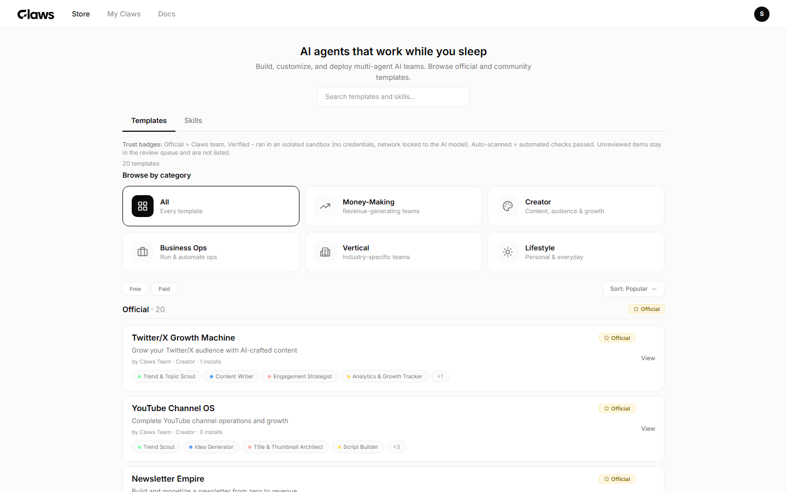
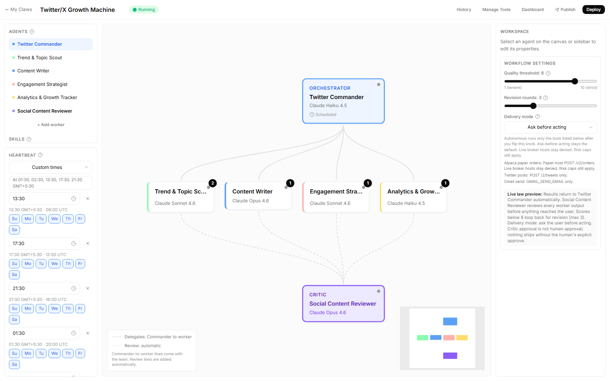
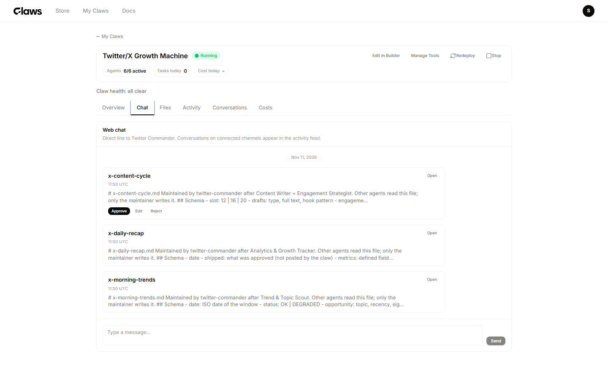
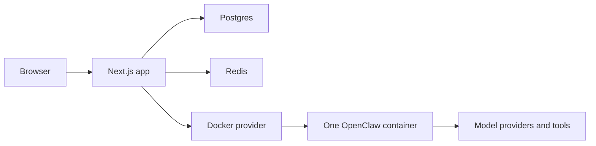

# Claws

A team of agents on your machine, with your keys.

[](https://github.com/Laxcorp-Research/claws/actions/workflows/ci.yml)
[](LICENSE)
[](https://github.com/Laxcorp-Research/claws/tags)

## Contents

- [Screenshots](#screenshots)
- [What Claws is](#what-claws-is)
- [Quickstart](#quickstart)
- [Your first five minutes](#your-first-five-minutes)
- [What ships](#what-ships)
- [How it works](#how-it-works)
- [How we know it works](#how-we-know-it-works)
- [Self-hosting](#self-hosting)
- [Templates and skills](#templates-and-skills)
- [Security](#security)
- [Roadmap (v1.1)](#roadmap-v11)
- [License and credits](#license-and-credits)

## Screenshots

Taken from a running self-host stack, viewport 1440 by 900.







## What Claws is

Claws is a platform for a team of agents, not a single assistant. One orchestrator talks to you, workers do the job, and a critic rejects weak work before you see it. It runs on your machine, with the model keys you paste. The gates are there so a verdict, a tool call, and anything that leaves the machine are checks the process performs. The platform in this repository is licensed AGPL-3.0-only, and the template and skill seed data is Apache-2.0.

## Quickstart

```bash
git clone https://github.com/Laxcorp-Research/claws && cd claws
cp .env.example .env
docker compose up -d
```

Open http://localhost:3000 and create your owner account.

What you see after that:

1. The store lists the seeded templates.
2. Install copies one template into a workspace you own. On a self-host install this does not open a checkout.
3. Deploy starts one container for that workspace.
4. Chat is the orchestrator. The first reply is the orchestrator, not a worker.

A timed stranger run of this path on v0.1.8, from clone through a real model reply, finished in 7 minutes 5 seconds (09:49:51Z to 09:56:56Z). About 7 minutes to a real reply (measured).

## Your first five minutes

1. From the store, install Twitter/X Growth Machine.
2. Deploy it.
3. In chat, say hello.
4. Connect Telegram: message @BotFather, send /newbot, paste the token.
5. On a decision card, click Approve.

## What ships

Twenty templates are seeded, in five categories. Agent counts include the orchestrator and the critic. There is no per-template directory.

### Money making

Watches a market, a pipeline, or a catalog and will not present work a gate rejected. Source: [prisma/seed-data/money-making-templates.ts](prisma/seed-data/money-making-templates.ts)

| Template | Agents | What it does |
| --- | ---: | --- |
| [Quant Trader](prisma/seed-data/money-making-templates.ts) | 7 | Watches markets, evaluates signals, backtests, and will not present a trade the risk gate rejected. |
| [Freelancer Revenue Engine](prisma/seed-data/money-making-templates.ts) | 6 | Finds freelance work, writes proposals, and tracks the work through to payment. |
| [E-Commerce Profit Maximizer](prisma/seed-data/money-making-templates.ts) | 7 | Researches products, tunes listings, and watches competitor prices. |

### Creator

Trends, drafts, and a critic for one audience. Source: [prisma/seed-data/creator-templates.ts](prisma/seed-data/creator-templates.ts)

| Template | Agents | What it does |
| --- | ---: | --- |
| [YouTube Channel OS](prisma/seed-data/creator-templates.ts) | 8 | Trends, ideas, titles, scripts, and SEO for one channel. |
| [Twitter/X Growth Machine](prisma/seed-data/creator-templates.ts) | 6 | Trend scanning, posts and threads, and audience analytics. |
| [Newsletter Empire](prisma/seed-data/creator-templates.ts) | 6 | Topic research, drafts, growth, and monetization notes. |
| [Podcast Production Studio](prisma/seed-data/creator-templates.ts) | 6 | Guest research, episode plans, show notes, and repurposing. |

### Business operations

Research, drafts, and an operating loop for a company function. Source: [prisma/seed-data/business-ops-templates.ts](prisma/seed-data/business-ops-templates.ts)

| Template | Agents | What it does |
| --- | ---: | --- |
| [B2B Sales Machine](prisma/seed-data/business-ops-templates.ts) | 7 | ICP research, lead enrichment, sequences, replies, and pipeline notes. |
| [Agency Operations OS](prisma/seed-data/business-ops-templates.ts) | 7 | Client intake, staffing, projects, reports, and the operating loop. |
| [Founder's Chief of Staff](prisma/seed-data/business-ops-templates.ts) | 6 | Morning briefings, meeting prep, action tracking, and drafts. |
| [SEO Empire Builder](prisma/seed-data/business-ops-templates.ts) | 7 | Keywords, articles, technical audits, backlink prospecting, and rank tracking. |

### Vertical

A trade, with the constraints that trade already has. Source: [prisma/seed-data/vertical-templates.ts](prisma/seed-data/vertical-templates.ts)

| Template | Agents | What it does |
| --- | ---: | --- |
| [Real Estate Agent OS](prisma/seed-data/vertical-templates.ts) | 6 | Lead qualification, market notes, showing coordination, and client messages. The seed includes Fair Housing rules. |
| [Recruiter OS](prisma/seed-data/vertical-templates.ts) | 6 | Sourcing, screening, interview coordination, and client reports. The seed includes anti-bias screening. |
| [Medical Practice Manager](prisma/seed-data/vertical-templates.ts) | 6 | Intake, appointments, recalls, and reviews. The seed includes HIPAA constraints. |
| [Law Firm Intake OS](prisma/seed-data/vertical-templates.ts) | 6 | First contact, case qualification, conflict checks, and consultation scheduling. |
| [Home Services Dispatcher](prisma/seed-data/vertical-templates.ts) | 5 | Call handling, dispatch, and follow-up. The seed includes an emergency protocol. |

### Lifestyle

A personal loop, with the limits the seed writes down. Source: [prisma/seed-data/lifestyle-templates.ts](prisma/seed-data/lifestyle-templates.ts)

| Template | Agents | What it does |
| --- | ---: | --- |
| [Health & Fitness Commander](prisma/seed-data/lifestyle-templates.ts) | 5 | Workouts, nutrition, and habits. The seed forbids invented science. |
| [Student Accelerator](prisma/seed-data/lifestyle-templates.ts) | 5 | Study plans, research help, and exam prep. The seed forbids writing the student's work. |
| [Job Hunter OS](prisma/seed-data/lifestyle-templates.ts) | 6 | Scouting, applications, interview coaching, and negotiation notes. |
| [Developer Productivity OS](prisma/seed-data/lifestyle-templates.ts) | 7 | PR review, issue triage, docs, security scanning, and standups. |

Telegram is a launch channel and is not labeled beta. Discord and Slack are launch channels labeled beta. WhatsApp and Microsoft Teams are staged.

## How it works



### One turn, end to end

1. You type in the dashboard, and the browser posts the chat.
2. If the container is stopped, the same container starts on the same volume. A message is the wake.
3. The app sends the turn to the runtime. In the smoke, the runtime health port answers before the chat is trusted.
4. The orchestrator receives the turn. A specialist is spawned with a task that stands alone, because the worker cannot see the parent conversation.
5. The worker's draft goes to the critic, which returns PASS or REJECT and must include the claims table. A missing table is not a pass.
6. An HTTP action waits for a one-shot permit whose body hash matches the body. You approve that on a card. A Quant paper order also has to clear the risk manager.
7. A document the team produced becomes a versioned card. Your approve, reject, or edit is pushed back into the claw. The agent is not polling a side file for that decision.
8. When the workspace is idle, outside a mission window, and has no run in flight, the platform may nap it. The next message starts at step 2, and the container log contains `Runtime state restored`.

### Why the pieces are split this way

| Constraint | Where it is enforced | What a prompt cannot do |
| --- | --- | --- |
| Who speaks to you | Orchestrator is `default: true` on 5.22, or `systemAgent.agentId` on 9.4 | A worker cannot become the inbox by asking |
| Who may run on a timer | Heartbeat config is written for the orchestrator only | A worker soul that says "check every hour" does not get a cron |
| What "good" means | `CriticVerdict` is `PASS` or `REJECT`, and the claims table is mandatory | A paragraph that praises the draft is not a pass |
| What may be called | HTTP method, host, and path on the skill contract | A URL invented in the reply is not a declared endpoint |
| Who injects the secret | Auth profile on the contract | A caller header named `authorization` is rejected |
| What may change the world | One-shot permit bound to `bodyHash` | Replaying the same permit with a different body fails |
| How big a Quant trade may be | `QUANT_MAX_*` env read by `evaluateQuantRiskManager` | Soul text that says "ignore the 20% cap" is not an input |
| What may leave the machine | `tools` deny list: `message`, `exec`, `process` | TOOLS.md saying "you may send" does not put the tool back |
| When the machine may stop | `decideMissionAwareHibernate` | Idle chat during a 45 minute mission window is not a nap |
| Which config shape boots | Zod schema for the deployed contract | A 5.22 `agents.list` file is not sent to a 9.4 runtime |

The full reference, with file paths, is [docs/ARCHITECTURE.md](docs/ARCHITECTURE.md).

## How we know it works

The self-host smoke uses the real runtime image. `e2e/self-host/deploy-chat.spec.ts` does this:

1. Install Twitter/X Growth Machine with a fixture key stored the way the wizard stores a key.
2. `POST /api/deploy/:id/cloud` returns 201, status `COMPLETED`, and `gatewayListening: true`.
3. The published runtime port answers `GET /healthz` with 200.
4. `POST /api/workspaces/:id/chat` with `hello` returns `fixture-reply`, with input and output usage both greater than zero.
5. `POST /api/dashboard/:id/nap` returns `HIBERNATED`, and `docker inspect` reports the container is not running.
6. A second chat, `hello again`, returns `fixture-reply` again, and `docker logs` contains `Runtime state restored`.

A count of `it(` and `test(` at the start of a line, in `*.test.ts`, `*.test.tsx`, `*.spec.ts`, and `*.spec.tsx` under `src/` and `e2e/`, is 4119 calls in 519 files. `it.each` is one call in that count, not one per row.

First-run issues found by stranger runs, labeled `first-run` on this repository:

| Issue | What broke |
| --- | --- |
| [#14](https://github.com/Laxcorp-Research/claws/issues/14) | The old install path died during image build on certificate verification. |
| [#16](https://github.com/Laxcorp-Research/claws/issues/16) | After the owner form, sign-in had no password field. |
| [#17](https://github.com/Laxcorp-Research/claws/issues/17) | Quickstart did not pull the runtime image. |
| [#20](https://github.com/Laxcorp-Research/claws/issues/20) | Installing Twitter/X Growth Machine opened a hosted checkout. |
| [#22](https://github.com/Laxcorp-Research/claws/issues/22) | Store search 500'd because `searchVector` was missing. |
| [#23](https://github.com/Laxcorp-Research/claws/issues/23) | Saving an API key failed when the container could not verify TLS. |
| [#24](https://github.com/Laxcorp-Research/claws/issues/24) | Install landed on a page that still talked about credits. |
| [#26](https://github.com/Laxcorp-Research/claws/issues/26) | Deploy reported running, then the runtime exited and chat could not connect. |
| [#28](https://github.com/Laxcorp-Research/claws/issues/28) | A healthy 9.4 deploy, then web chat 502 because the runtime rejected the app. |
| [#30](https://github.com/Laxcorp-Research/claws/issues/30) | 9.4 accepted the upgrade, then rejected the app origin. |
| [#32](https://github.com/Laxcorp-Research/claws/issues/32) | The setup key validated, deploy succeeded, and web chat returned an empty reply. |
| [#34](https://github.com/Laxcorp-Research/claws/issues/34) | Nap refused because state sync returned HTTP 401, so the claw never slept. |

The numbers are not a continuous range. Other issue numbers in between are not first-run bugs.

The fixture doctrine is: test the contract, not every integration the store can name. `skill-http-contracts.test.ts` locks method, host, path, and class for the 31 tool-specific skills, and the store's "1,100+" label is a floor (`TOOL_COUNT_MARKETING_FLOOR` is 1100 in `src/lib/tools/tool-count-label.ts`) that never drops, including at a catalog count of 0, so it is not evidence that 1,500 integrations were executed.

## Self-hosting

The operational document is [SELF_HOSTING.md](SELF_HOSTING.md). Read it before you expose the host, including the secrets to rotate.

Docker Engine and Compose. No Node toolchain is required to run the stack. The images are `ghcr.io/laxcorp-research/claws:latest`, `ghcr.io/laxcorp-research/openclaw-runtime` at `RUNTIME_IMAGE_TAG` (the default in `docker-compose.yml` is `2026.9.4-5`), `postgres:16`, and `redis:7`. The app listens on port 3000. The healthcheck is `GET /api/health`.

| Data | Where |
| --- | --- |
| Control plane database | Named volume `claws-pg` |
| Redis | Named volume `claws-redis` |
| Runtime snapshots on disk | Named volume `claws-snapshots`, path `CLAWS_SNAPSHOT_DIR` |
| One claw's files | Named volume `claws-${workspaceId}`, same name as the container |

Back up the named volumes. `claws-pg` is the database. `claws-snapshots` is the on-disk copy of runtime state. Each `claws-${workspaceId}` volume is that claw's workspace files. Copying the git checkout does not copy any of those. Nap keeps the per-claw volume. The terminal teardown removes the container and that volume.

```bash
docker compose pull
docker compose up -d
```

The Compose file uses `image:` and `pull_policy: always` on the app. It has no `build:` key. Changing `RUNTIME_IMAGE_TAG` pulls that image on the next `up`.

If setup says the network intercepts HTTPS, or `/api/health` reports `outbound.anthropic` as `tls_intercepted`, follow [Behind a corporate proxy](SELF_HOSTING.md#behind-a-corporate-proxy) in SELF_HOSTING.md.

## Templates and skills

The Builder is `src/app/builder/[workspaceId]/page.tsx`. Canvas state lives in `src/stores/builder-store.ts`. You add agents, set roles, attach skills, and save. Deploy then runs the same generator as a seeded template.

Seeded templates are TypeScript objects in these files. `prisma/seed-data/index.ts` concatenates them and throws if the length is not 20.

- [prisma/seed-data/money-making-templates.ts](prisma/seed-data/money-making-templates.ts)
- [prisma/seed-data/creator-templates.ts](prisma/seed-data/creator-templates.ts)
- [prisma/seed-data/business-ops-templates.ts](prisma/seed-data/business-ops-templates.ts)
- [prisma/seed-data/vertical-templates.ts](prisma/seed-data/vertical-templates.ts)
- [prisma/seed-data/lifestyle-templates.ts](prisma/seed-data/lifestyle-templates.ts)

Tool-specific skills are `prisma/seed-data/skills-tool-specific.ts`. HTTP contracts for those skills are `src/lib/openclaw/skill-http-contracts.ts`.

Open a pull request that adds the template object to the matching seed file, exports it through `prisma/seed-data/index.ts`, and updates the length lock in that same change. A skill that calls HTTP needs a contract entry in the same pull request, or `skill-http-contracts.test.ts` fails.

There is no remote template registry in this tree. Registry mode is v1.1.

## Security

Report a vulnerability in private: [GitHub private vulnerability reporting](https://github.com/Laxcorp-Research/claws/security/advisories/new). The policy, including master-key rotation, is [SECURITY.md](SECURITY.md). Do not open a public issue that contains a live credential.

Keys at rest use AES-256-GCM. The master key is hex, and a previous key is consulted only during rotation, so existing ciphertext still decrypts.

The database volume, the Redis volume, the snapshot volume, each claw's volume, and the encrypted key rows stay on the machine. What leaves is the model request to the provider whose key you stored, and any HTTP call a permitted action makes.

## Roadmap (v1.1)

WhatsApp QR: the schema accepts pairing and an auth directory, and this repository does not contain a QR pairing screen. WhatsApp and Microsoft Teams are staged, not launch channels.

Template registry: the catalog is the seed files above. A registry you can publish to, separate from a pull request, is not in this tree.

SMTP: self-host magic link already turns on when `RESEND_API_KEY` is set or any `SMTP_*` variable is non-placeholder. A mail setup beyond that env check is not a screen in the owner flow.

Discord and Slack receipts: both are launch channels labeled beta, and Telegram is not. A delivery receipt that confirms the channel accepted the message is not a separate module here.

## License and credits

The platform is [GNU Affero General Public License v3.0 only](LICENSE). Copyright 2026 Laxcorp Research, in [NOTICE](NOTICE).

Files under `prisma/seed-data/` are Apache License 2.0. See [prisma/seed-data/LICENSE](prisma/seed-data/LICENSE).

The runtime underneath each team is [OpenClaw](https://github.com/openclaw/openclaw). This repository is the control plane: it generates OpenClaw config and runs the OpenClaw container. It is not a fork of the runtime.

Laxcorp Research, Dubai. The schedule tests use `Asia/Dubai` as the founder timezone (`src/lib/schedule/__tests__/cron-tz-parity.test.ts`). NOTICE records the copyright holder and does not record a street address.
