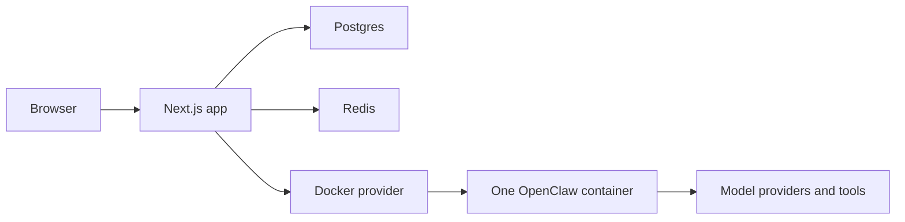
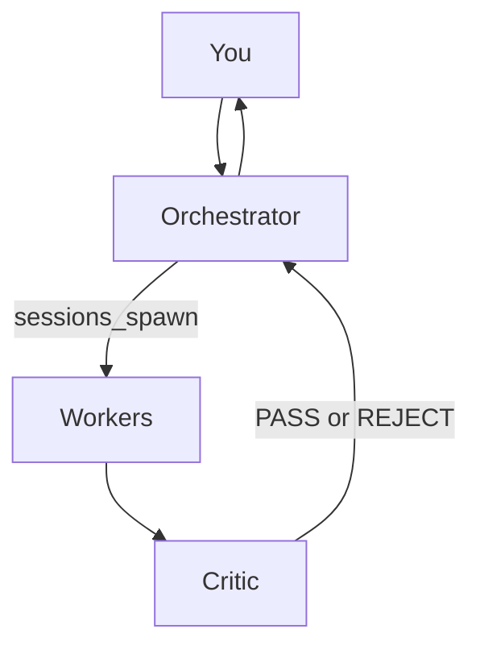

# Claws

Claws is a platform for a team of agents, not a single assistant. One orchestrator talks to you. Workers do the job. A critic rejects weak work before you see it. It runs on your machine, with the model keys you paste. The platform in this repository is licensed AGPL-3.0-only. The template and skill seed data is Apache-2.0.

The runtime underneath each team is [OpenClaw](https://github.com/openclaw/openclaw). This repository is the control plane: the database, the generator that writes each workspace, the Docker provider that starts one container per claw, and the gates that sit in front of anything that leaves the machine.

## Quickstart

Requirements: Docker Engine with Compose. Nothing is compiled on your machine. The control plane image is pulled.

```bash
git clone https://github.com/Laxcorp-Research/claws && cd claws
cp .env.example .env
docker compose up -d
```

`docker-compose.yml` starts four things: Postgres 16, Redis 7, a one-shot pull of `ghcr.io/laxcorp-research/openclaw-runtime` (the shipped tag is `2026.9.4-5`), and `ghcr.io/laxcorp-research/claws:latest` on port 3000. The app healthcheck is `GET /api/health`.

Open http://localhost:3000 and create your owner account. The form is `src/app/setup/owner/page.tsx`. It posts to `POST /api/setup/owner` and creates the only account. Later sign-ins use that email and password.

What you see after that:

1. The store lists the seeded templates.
2. Install copies one template into a workspace you own. On a self-host install this does not open a checkout.
3. Deploy starts one OpenClaw container for that workspace.
4. Chat is the orchestrator. The first reply is the orchestrator, not a worker.

A timed stranger run of this path on v0.1.8, from clone through a real model reply and a later persistence check, finished in 7 minutes 5 seconds (09:49:51Z to 09:56:56Z). Plan on several minutes, most of it image pull and the first model call.

Before you expose the host, change `CLAWS_NEXTAUTH_SECRET`, `CLAWS_ENCRYPTION_MASTER_KEY` (64 hex characters), `POSTGRES_PASSWORD`, and `CLAWS_METERING_MASTER_SECRET` in `.env`. The rest of the bring-up, including a corporate proxy, is in [SELF_HOSTING.md](SELF_HOSTING.md).

## What ships

Twenty templates are seeded. `prisma/seed-data/index.ts` builds `ALL_TEMPLATES` from five category files and throws if the length is not 20. There is no per-template directory. Each row below links to the seed file that contains that slug.

Agent counts are the length of that template's `agents` array, which includes the orchestrator and the critic.

### Money making

Source: [prisma/seed-data/money-making-templates.ts](prisma/seed-data/money-making-templates.ts)

| Template | Agents | What it does |
| --- | ---: | --- |
| [Quant Trader](prisma/seed-data/money-making-templates.ts) | 7 | Watches markets, evaluates signals, backtests, and will not present a trade the risk gate rejected. |
| [Freelancer Revenue Engine](prisma/seed-data/money-making-templates.ts) | 6 | Finds freelance work, writes proposals, and tracks the work through to payment. |
| [E-Commerce Profit Maximizer](prisma/seed-data/money-making-templates.ts) | 7 | Researches products, tunes listings, and watches competitor prices. |

### Creator

Source: [prisma/seed-data/creator-templates.ts](prisma/seed-data/creator-templates.ts)

| Template | Agents | What it does |
| --- | ---: | --- |
| [YouTube Channel OS](prisma/seed-data/creator-templates.ts) | 8 | Trends, ideas, titles, scripts, and SEO for one channel. |
| [Twitter/X Growth Machine](prisma/seed-data/creator-templates.ts) | 6 | Trend scanning, posts and threads, and audience analytics. |
| [Newsletter Empire](prisma/seed-data/creator-templates.ts) | 6 | Topic research, drafts, growth, and monetization notes. |
| [Podcast Production Studio](prisma/seed-data/creator-templates.ts) | 6 | Guest research, episode plans, show notes, and repurposing. |

### Business operations

Source: [prisma/seed-data/business-ops-templates.ts](prisma/seed-data/business-ops-templates.ts)

| Template | Agents | What it does |
| --- | ---: | --- |
| [B2B Sales Machine](prisma/seed-data/business-ops-templates.ts) | 7 | ICP research, lead enrichment, sequences, replies, and pipeline notes. |
| [Agency Operations OS](prisma/seed-data/business-ops-templates.ts) | 7 | Client intake, staffing, projects, reports, and the operating loop. |
| [Founder's Chief of Staff](prisma/seed-data/business-ops-templates.ts) | 6 | Morning briefings, meeting prep, action tracking, and drafts. |
| [SEO Empire Builder](prisma/seed-data/business-ops-templates.ts) | 7 | Keywords, articles, technical audits, backlink prospecting, and rank tracking. |

### Vertical

Source: [prisma/seed-data/vertical-templates.ts](prisma/seed-data/vertical-templates.ts)

| Template | Agents | What it does |
| --- | ---: | --- |
| [Real Estate Agent OS](prisma/seed-data/vertical-templates.ts) | 6 | Lead qualification, market notes, showing coordination, and client messages. The seed includes Fair Housing rules. |
| [Recruiter OS](prisma/seed-data/vertical-templates.ts) | 6 | Sourcing, screening, interview coordination, and client reports. The seed includes anti-bias screening. |
| [Medical Practice Manager](prisma/seed-data/vertical-templates.ts) | 6 | Intake, appointments, recalls, and reviews. The seed includes HIPAA constraints. |
| [Law Firm Intake OS](prisma/seed-data/vertical-templates.ts) | 6 | First contact, case qualification, conflict checks, and consultation scheduling. |
| [Home Services Dispatcher](prisma/seed-data/vertical-templates.ts) | 5 | Call handling, dispatch, and follow-up. The seed includes an emergency protocol. |

### Lifestyle

Source: [prisma/seed-data/lifestyle-templates.ts](prisma/seed-data/lifestyle-templates.ts)

| Template | Agents | What it does |
| --- | ---: | --- |
| [Health & Fitness Commander](prisma/seed-data/lifestyle-templates.ts) | 5 | Workouts, nutrition, and habits. The seed forbids invented science. |
| [Student Accelerator](prisma/seed-data/lifestyle-templates.ts) | 5 | Study plans, research help, and exam prep. The seed forbids writing the student's work. |
| [Job Hunter OS](prisma/seed-data/lifestyle-templates.ts) | 6 | Scouting, applications, interview coaching, and negotiation notes. |
| [Developer Productivity OS](prisma/seed-data/lifestyle-templates.ts) | 7 | PR review, issue triage, docs, security scanning, and standups. |

Telegram is a launch channel and is not labeled beta. Discord and Slack are launch channels labeled beta. WhatsApp and Microsoft Teams are staged channel ids: the config schema exists, and they are not in `LAUNCH_CHANNEL_IDS`. See `src/lib/openclaw/channel-config.ts` and `src/lib/ui/__tests__/beta-labels.test.ts`.

## Architecture



The browser talks only to the Next.js app. The app keeps workspace rows, keys, and runtime state in Postgres, and uses Redis for short-lived coordination. Deploy goes through `src/lib/openclaw/deployer.ts` to `src/lib/openclaw/docker-provider.ts`, which talks to the Docker socket. Each workspace gets one container and one named volume, both named `claws-${workspaceId}` (`src/lib/openclaw/docker-engine.ts`). The container calls the model provider and the tool hosts you configured. It does not get a path to send mail, run a shell, or post a message on its own. That denial is config, described below.

### One turn, end to end

This is the path a chat message takes. The files are the ones the tests lock.

1. You type in the dashboard. The browser posts to `POST /api/workspaces/:id/chat`. The smoke test in `e2e/self-host/deploy-chat.spec.ts` uses that route and expects `data.replyText`.
2. If the container is stopped, the wake path starts the same container on the same volume. Hibernation does not create a second container. `wakeWorkspace` is what `src/lib/artifacts/decision-push.ts` calls before it sends a decision, and the chat route uses the same idea: a message is the wake.
3. The app sends the turn to the runtime. The runtime's health port in the smoke test is 18789 inside the container (`docker port` on `18789/tcp`, then `GET /healthz`).
4. The orchestrator is the agent that receives the turn. Workers are not bound to the dashboard. If the work needs a specialist, the orchestrator's `AGENTS.md` tells it to call `sessions_spawn` with that worker's agent id and a task that stands alone, because the worker cannot see the parent conversation (`src/lib/openclaw/generator.ts`).
5. The worker's draft goes to the critic. The critic returns `PASS` or `REJECT` and must include the claims table (`src/lib/critic/claims-table.ts`). A missing table is not a pass.
6. If the next step is an HTTP `ACTION`, the call waits for a one-shot permit whose `bodyHash` matches the body (`src/lib/openclaw/http-permit.ts`). You approve that on a card (`src/lib/openclaw/http-action-card.ts`). Quant Trader also has to clear `evaluateQuantRiskManager` before a paper order is eligible (`src/lib/quant/risk-limits.ts`).
7. A document the team produced is extracted and written as a versioned deliverable (`src/lib/artifacts/live-write.ts`). The dashboard shows it as a card. Your approve, reject, or edit is pushed back with `pushDecisionToClaw`. The agent is not polling a side file for that decision.
8. When the workspace is idle, outside a mission window, and has no run in flight, the platform may nap it (`src/lib/hibernation/mission-idle.ts`). The next message starts at step 2. The container log line the smoke test requires after that wake is `Runtime state restored`.

Nothing in that list is a model instruction that the model is trusted to obey. The spawn text is an instruction. The claims table, the permit hash, the tool denial, and the risk numbers are checks the process performs.

### Why the pieces are split this way

A single assistant with a long prompt can describe a team. It cannot make the critic's verdict a type, and it cannot make `message` disappear from the tool list. Claws splits the work so that each constraint has a place that fails closed:

| Constraint | Where it is enforced | What a prompt cannot do |
| --- | --- | --- |
| Who speaks to you | Orchestrator is `default: true` on 5.22, or `systemAgent.agentId` on 9.4 | A worker cannot become the inbox by asking |
| Who may run on a timer | Heartbeat config is written for the orchestrator only | A worker soul that says "check every hour" does not get a cron |
| What "good" means | `CriticVerdict` is `PASS` or `REJECT`, and the claims table is mandatory | A paragraph that praises the draft is not a pass |
| What may be called | HTTP method, host, and path on the skill contract | A URL invented in the reply is not a declared endpoint |
| Who injects the secret | Auth profile on the contract | A caller header named `authorization` is rejected |
| What may change the world | One-shot permit bound to `bodyHash` | Replaying the same permit with a different body fails |
| How big a Quant trade may be | `QUANT_MAX_*` env read by `evaluateQuantRiskManager` | Soul text that says "ignore the 20% cap" is not an input |
| What may leave the machine | `tools` deny list: `message`, `exec`, `process` | TOOLS.md saying "you may send" does not put the tool back |
| When the machine may stop | `decideMissionAwareHibernate` | Idle chat during a 45 minute mission window is not a nap |
| Which config shape boots | Zod schema for the deployed contract | A 5.22 `agents.list` file is not sent to a 9.4 runtime |

The OpenClaw schema is strict. [docs/RUNTIME_CONTRACTS.md](docs/RUNTIME_CONTRACTS.md) records that `openclaw.json` has to parse `OpenClawSchema` or the runtime refuses to boot, and unknown keys fail closed. The generator's job is to emit a file that parses, not to attach extra fields and hope they are ignored.

On the 9.4 contract the emitted shape is:

- `agents.ownership` is `explicit`
- `agents.entries` is a map keyed by agent id
- there is no `agents.list` and no `default: true`
- `agents.defaults.systemAgent.agentId` is the orchestrator
- agent ids are the normalized form `toAgentId` already produces, lowercase `[a-z0-9-]`, at most 64 characters

On the 5.22 contract the emitted shape is `agents.list`, and the orchestrator entry carries `default: true`. The generator chooses one. It does not emit both.

On the 9.4 contract the generated `.env` contains `OPENCLAW_CONFIG_READONLY=1` (`src/lib/openclaw/generator.ts`). The 5.22 runtime has no such knob. `src/lib/openclaw/__tests__/runtime-contract-emission.test.ts` asserts the line is present for 9.4 and absent for 5.22. The flag exists so the runtime's doctor cannot rewrite the file the generator owns. A running container that rewrites its config would desync the database from the file the next deploy writes on purpose.

Plugins the overlay adds are declared, not discovered. The contract doc names `claws-activity-reporter` (hooks allowed to see the conversation) and `admin-http-rpc`. The sync route those plugins expose is how state gets out of the container before a nap. A 401 on that route is `sync-failed-http-401`, and nap refuses.

### What self-host leaves out

`CLAWS_PROFILE=self-host` is the Compose default path. [SELF_HOSTING.md](SELF_HOSTING.md) lists the modules that answer 404 with `HOSTED_ONLY`:

- Dodo Payments checkout, webhooks, and creator payouts
- The shared credit pool and credit proxy
- The Railway governor and service pool
- Fly Machines
- Hosted cron fan-out
- The Composio broker (OAuth and hosted key brokering)

Direct API-key tools still save. The HTTP contracts for those skills still apply. A self-host install does not need a hosted account, and the install route must not redirect into checkout. That redirect was first-run issue #20.

The password on the owner form has a minimum of 12 characters (`SELF_HOSTING.md`). Values stored for model or tool keys that start with `fixture-` are kept without a live provider call. A real key is checked. Do not put either kind of key in `docker-compose.yml` or `.env`. Keys belong in the workspace, encrypted with the master key.

### The agent team



A workspace has one orchestrator, one or more workers, and one critic. The generator writes the orchestrator's instructions so that delegation is `sessions_spawn(agentId, task, label)`. The worker does not see the orchestrator's conversation. The result comes back on the announce chain. The generator tells the orchestrator not to pass a `model` argument on that call, because the model is already set per agent. That text is emitted in `src/lib/openclaw/generator.ts` in the section titled "Task Delegation - Using sessions_spawn".

Heartbeats are attached to the orchestrator only. The generator comment at that site says the orchestrator is the only agent that runs them.

Channel routing is not a `bindings` entry. An earlier generator emitted `bindings: [{ agentId: orchestrator, match: { channel: "*" } }]`. OpenClaw's binding index is an exact channel-name map, so `*` matches a channel literally named `*`, and the entry was a no-op. The generator now omits `bindings` on purpose. Unmatched channel traffic and the dashboard fallback go to the orchestrator by a version-specific field:

- Runtime contract 5.22: the orchestrator list entry has `default: true`.
- Runtime contract 9.4: `agents.ownership` is `explicit`, and `agents.defaults.systemAgent.agentId` is the orchestrator. Explicit ownership cannot be combined with `default: true`.

Both shapes are in `src/lib/openclaw/generator.ts`. The Zod lock for the two shapes is described in [docs/RUNTIME_CONTRACTS.md](docs/RUNTIME_CONTRACTS.md).

The critic is a procedure, not a paragraph of advice. `src/lib/critic/claims-table.ts` defines `CriticVerdict` as `"PASS" | "REJECT"`. A review that does not include the mandatory claims table (`| Claim | Source |`, plus the dimension score table) is not a pass. The file's own comment says dropping the table step and treating a missing table as PASS fails `claims-table.test.ts`. Quant Trader adds a second mechanical gate in `src/lib/quant/critic-gate.ts`. Prose in a soul file is not a rail. The delivery section below is the rail.

The score table header is `| Dimension | Score | Anchor |`. The default dimensions are `fit`, `pricing`, `specificity`, and `tone`. Templates that need a different net have their own four:

| Template family | Dimensions |
| --- | --- |
| Quant Trader | `thesis-quality`, `risk-adherence`, `evidence`, `regime-fit` |
| E-commerce | `margin-truth`, `listing-quality`, `policy-compliance`, `evidence` |
| YouTube | `hook`, `retention-logic`, `originality`, `policy` |
| Newsletter | `subject-promise`, `issue-density`, `voice-fit`, `policy` |
| Podcast | `guest-fit`, `brief-clarity`, `repurpose-plan`, `policy` |
| B2B sales | `relevance`, `compliance`, `specificity`, `tone` |
| Agency | `scope-integrity`, `utilization-truth`, `margin-truth`, `client-clarity` |
| Chief of staff | `briefing-completeness`, `commitment-fidelity`, `tone`, `off-limits` |
| SEO | `eeat`, `intent-fit`, `ymyl-safety`, `evidence` |

The same file continues the pattern for the vertical templates (real estate starts with `fair-housing`, `cma-accuracy`, and `speed-to-lead`). A new template that needs its own net adds a constant there and a test that a review without those rows is a reject. A new template that reuses `fit` / `pricing` / `specificity` / `tone` does not need a new constant. Either way the verdict type does not grow a third value. There is no `MAYBE`.

### Workspace generation

The database is the source. Deploy reads the workspace and writes the files the runtime reads:

- `SOUL.md` for who the agent is
- `AGENTS.md` for how the team delegates
- `HEARTBEAT.md` for the cron windows
- `USER.md` for who the human is
- `TOOLS.md` for the tools and the delivery rules
- `openclaw.json` for the runtime config

`src/lib/openclaw/generator.ts` builds `openclaw.json` with only fields that exist on the OpenClaw Zod schema for the contract that workspace is deployed on. A 5.22 file uses `agents.list`. A 9.4 file uses `agents.entries` as a map keyed by agent id, with no inner id field and no `default` flag. Mixing them is a failed deploy, not a best-effort rewrite. The contract document is [docs/RUNTIME_CONTRACTS.md](docs/RUNTIME_CONTRACTS.md).

Runtime state is snapshotted in Postgres on `ContainerState`. `src/lib/openclaw/state-snapshot.ts` persists that snapshot in one SQL `UPDATE`. The same statement copies the current bytes into `runtimeStatePrevSnapshot` before it overwrites `runtimeStateSnapshot`. Postgres reads the old tuple on the right-hand side of `SET`, so the shift and the write cannot tear. A single-column overwrite used to destroy the last 5.22-shaped snapshot the moment the first 9.4 persist landed. The first persist after a contract change also copies the outgoing snapshot into `preMigrationSnapshot` and pins it for 7 days, when that slot is empty or the previous pin has expired. Rollback material is those two generations plus the pre-migration pin, not a manual export.

Self-host also writes the snapshot under `CLAWS_SNAPSHOT_DIR` (`/var/lib/claws/snapshots` in Compose, volume `claws-snapshots`).

The row that holds this is `ContainerState`. The columns the persist function moves, in one statement, are:

| Column | Role |
| --- | --- |
| `runtimeStateSnapshot` | The current bytes. |
| `runtimeStatePrevSnapshot` | The previous generation, copied from the current column in the same `UPDATE`. |
| `runtimeStateContract` | The contract those bytes were written under. |
| `deployedRuntimeContract` | The contract the running container was deployed with. |
| `preMigrationSnapshot` | A third copy, taken only when those two contract columns differ and the pin slot is free. |
| `preMigrationPinnedUntil` | Seven days from that copy. A later contract change does not overwrite the pin while it is still in the future. |

`src/lib/openclaw/__tests__/state-snapshot-generations.test.ts` is the test for the shift. The comment in `state-snapshot.ts` names the failure it closed: a one-column overwrite on 2026-09-13 deleted the last 5.22 snapshot as soon as the first 9.4 persist landed, and the rollback bytes were gone. The right-hand side of the `SET` reads the old tuple, so the copy and the overwrite cannot land as two steps.

### Schedules

You type a local time. The stored instant is UTC. The timezone you authored in is pinned on the schedule as `authoredTz` (`src/lib/schedule/types.ts`, `src/lib/schedule/persist.ts`). A daily 08:00 authored in `Asia/Dubai` fires at 04:00Z, and the platform expects 04:00Z. That case is `src/lib/schedule/__tests__/cron-tz-parity.test.ts`.

`HEARTBEAT.md` windows that the template stamped as UTC stay UTC. They do not slide when the workspace timezone is Dubai. The same test file locks that: a template UTC 08:00 still fires at 08:00Z. A stamped daily or weekday JSON that carries `authoredTz` is the pin. An unstamped window is not.

The generator writes real cron expressions into `HEARTBEAT.md`. It does not write "every morning" and hope the model notices.

### Hibernation

An idle claw stops. The container and the named volume stay. `src/lib/openclaw/docker-provider.ts` treats stop as hibernation and a separate teardown as the path that deletes the volume.

The next message wakes it. The CI smoke posts a chat after nap and expects the container log to contain `Runtime state restored` (`e2e/self-host/deploy-chat.spec.ts`).

Sleep is mission-aware. `src/lib/hibernation/mission-idle.ts` exports `decideMissionAwareHibernate`. It is true only when chat is idle, no run is in flight, and the clock is outside the mission window. `MISSION_WINDOW_MAX_MS` is 45 minutes after a scheduled window fire. A claw inside that window, or with a subagent still running, is not a nap candidate.

State is synced before the stop. A sync that returns HTTP 401 refuses the nap. That refusal was first-run issue #34. The heal condition id is `sync-failed-http-401`.

### The HTTP action rail

Each tool-specific skill declares its HTTP endpoints. An endpoint is `READ` or `ACTION` (`src/lib/openclaw/http-contract.ts`). The method, host, and path are part of the declaration. Auth is injected by a named profile (`bearer`, `alpaca-dual-header`, `x-api-key`, and the others in `HTTP_AUTH_PROFILES`). The caller is forbidden from supplying `authorization`, `apca-api-key-id`, `x-api-key`, and the other names in `FORBIDDEN_CALLER_HEADER_NAMES`.

An `ACTION` call needs a one-shot permit. `src/lib/openclaw/http-permit.ts` stores `bodyHash` on that permit and records consumption. A second call, or a call whose body does not hash to the same value, does not reuse it. The approval card the dashboard shows is built in `src/lib/openclaw/http-action-card.ts`.

Quant Trader's risk gate sits in front of that rail for the trading skill. `src/lib/quant/risk-limits.ts` is machine-owned env, not soul text. The defaults are notional at most 20% of equity per name, risk at most 2% of equity via stop distance (`qty * |entry - stop|`), and daily loss at most 3%. The paper host is `paper-api.alpaca.markets`. The live host `api.alpaca.markets` stays denied. The file says soul text cannot raise the limits, point the host at live Alpaca, or clear the kill switch. There is no override argument.

`src/lib/openclaw/__tests__/skill-http-contracts.test.ts` requires a contract for every tool-specific skill. The current seed has 31 of those skills, and the test expects 31 contracts.

### Self-healing ops

`src/lib/healing/conditions.ts` exports `PHASE_A_CONDITION_IDS`. The array length is 46. `src/lib/healing/__tests__/runtime-heals.test.ts` fails if that length changes. `src/lib/healing/registry.ts` has one `HEAL_REGISTRY` row per id. A row says who may heal it (`platform`, `user-only`, `owner-only`, or a deferred bucket), which function already exists to do the heal, how many retries, and whether exhaustion is `owner-alert`, `customer-alert`, or `none`.

Several platform rows retry 3 times and then escalate to `owner-alert` (for example `bad-token`, `plugin-not-loaded`, `probe-degraded`). That retry field is not a global dedup. Owner pages for critical alerts use a 12 hour cooldown in `src/lib/alerts/critical-alert-push.ts`. A separate path, the third sync-fail exhaust, writes one owner page and one alert-pushed ledger row (`src/lib/hibernation/__tests__/stale-destroy.test.ts`). `digest-missed` is its own condition, so a digest that did not run is a recorded failure rather than a silent gap.

The 46 ids, in registry order:

```text
state-sync-stale
fingerprint-config-drift
bad-token
plugin-not-loaded
env-credential-drift
probe-failure
error-self-heal
probe-degraded
heartbeat-missed-running
heartbeat-missed-wake
heartbeat-woke-late
activity-silence
hibernation-refused
stuck-waking
deploy-failed
stranded-deployment
provisioning-queued
railway-create-budget
keyless-boot
needs-credentials-tools
mcp-session-dead
version-update
oauth-expired
tool-connection-error
twitter-402-tier
tool-429
credits-exhausted
trial-lapse
subscription-failed
subscription-on-hold
payment-failed
spend-limit-100
credit-pool
credit-balance-drift
email-delivery-failed
channel-send-failed
thinking-signature-poison
cron-job-failed
state-sync-near-cap
mission_interrupted
pending-approval-unactioned
railway-domain-cap
silent-wake
digest-missed
provider_auth_missing
sync-failed-http-401
```

Guards matter more than the retry count. `fingerprint-config-drift` is banner-only and does not auto-redeploy a running claw. Hosted-only conditions such as `credit-pool` and `railway-create-budget` are owner-plane. On a self-host profile those modules 404 with `HOSTED_ONLY` ([SELF_HOSTING.md](SELF_HOSTING.md)).

### Artifacts

Documents the agents produce are extracted into the workspace as deliverables and shown on the dashboard as cards. Kinds include a decision, a report, and an HTTP action. The write path is `src/lib/artifacts/live-write.ts`. Extraction emits the event kind `deliverable_extracted`. Versions are rows, not an overwrite of a single blob: the file-version history keeps the content hash, the trigger, and the decision.

A human decision is pushed into the running claw. `src/lib/artifacts/decision-push.ts` exports `pushDecisionToClaw`. The decision kinds are `APPROVED`, `REJECTED`, and `EDITED`. The push wakes the workspace if it is asleep, then sends a chat message. It does not wait for the agent to poll. The sidecar status file is not a promise to send. `SIDECAR_DECISION_TRUTH_COPY` in `src/lib/openclaw/delivery-rail.ts` says the sidecar `status.json` is the source of truth for `QUEUED` and `HELD`, and the agent must not tell you the message has already gone out.

### Delivery rail

The agent cannot send externally by itself. Approved output goes through the rail. `src/lib/openclaw/delivery-rail.ts` sets `OUTBOUND_ACTION_DENY` to `message`, `exec`, and `process`, and the generator writes that denial into the runtime tool policy. The file's comment is the design rule: prose alone is not a rail.

`CRITIC_NE_HUMAN_COPY` in the same file says a critic PASS is not a human approval. An action that leaves the machine still needs the permit and the card.

With zero external channels, the `message` tool is denied outright (`NO_CHANNEL_TOOL_DENY` in `src/lib/openclaw/message-delivery.ts`). Web chat does not need a channel. Leaving the tool enabled in that case made the model recite an upstream CLI error to the human.

Tools that are allowed to be autonomous are an explicit list in the same delivery file, not a default. The list today is the Alpaca paper order endpoint, a Twitter/X post endpoint, and a Gmail send endpoint, each still behind the HTTP contract and the permit. Adding a skill to a soul file does not add it to that list.

## Tests and how we know it works

A count of `it(` and `test(` at the start of a line, in `*.test.ts`, `*.test.tsx`, `*.spec.ts`, and `*.spec.tsx` under `src/` and `e2e/`, is 4119 calls in 519 files. `it.each` is one call in that count, not one per row. CI runs them as "Unit & Integration Tests" and "E2E Tests" (`.github/workflows/ci.yml`).

The self-host smoke uses the real runtime image, not a stub container. `e2e/self-host/deploy-chat.spec.ts` does this:

1. Install Twitter/X Growth Machine with a fixture key stored the way the wizard stores a key.
2. `POST /api/deploy/:id/cloud` returns 201, status `COMPLETED`, and `gatewayListening: true`.
3. The published runtime port answers `GET /healthz` with 200.
4. `POST /api/workspaces/:id/chat` with `hello` returns `fixture-reply`, with input and output usage both greater than zero.
5. `POST /api/dashboard/:id/nap` returns `HIBERNATED`, and `docker inspect` reports the container is not running.
6. A second chat, `hello again`, returns `fixture-reply` again, and `docker logs` contains `Runtime state restored`.

That reply text is the fixture model. It proves the path from a stored key through deploy, chat, nap, and wake. It does not prove a particular vendor model wrote a good paragraph. The stranger run cited in the quickstart is the run that used a real key.

First-run issues found by those stranger runs, labeled `first-run` on this repository:

| Issue | What broke |
| --- | --- |
| [#14](https://github.com/Laxcorp-Research/claws/issues/14) | The old install path died during image build on certificate verification. |
| [#16](https://github.com/Laxcorp-Research/claws/issues/16) | After the owner form, sign-in had no password field. |
| [#17](https://github.com/Laxcorp-Research/claws/issues/17) | Quickstart did not pull the runtime image. |
| [#20](https://github.com/Laxcorp-Research/claws/issues/20) | Installing Twitter/X Growth Machine opened a hosted checkout. |
| [#22](https://github.com/Laxcorp-Research/claws/issues/22) | Store search 500'd because `searchVector` was missing. |
| [#23](https://github.com/Laxcorp-Research/claws/issues/23) | Saving an API key failed when the container could not verify TLS. |
| [#24](https://github.com/Laxcorp-Research/claws/issues/24) | Install landed on a page that still talked about credits. |
| [#26](https://github.com/Laxcorp-Research/claws/issues/26) | Deploy reported running, then the runtime exited and chat could not connect. |
| [#28](https://github.com/Laxcorp-Research/claws/issues/28) | A healthy 9.4 deploy, then web chat 502 because the runtime rejected the app. |
| [#30](https://github.com/Laxcorp-Research/claws/issues/30) | 9.4 accepted the upgrade, then rejected the app origin. |
| [#32](https://github.com/Laxcorp-Research/claws/issues/32) | The setup key validated, deploy succeeded, and web chat returned an empty reply. |
| [#34](https://github.com/Laxcorp-Research/claws/issues/34) | Nap refused because state sync returned HTTP 401, so the claw never slept. |

The numbers are not a continuous range. Other issue numbers in between are not first-run bugs. Each of these was locked with a test that fails if the old behavior comes back, rather than a comment that says the bug is fixed.

The fixture doctrine is: test the contract, not every integration the store can name. `skill-http-contracts.test.ts` locks method, host, path, and class for the 31 tool-specific skills. The store's "1,100+" style label is a floor (`TOOL_COUNT_MARKETING_FLOOR` is 1100 in `src/lib/tools/tool-count-label.ts`). `formatToolCountFloorLabel` never returns a lower number, including when the catalog count is 0. That label is not evidence that 1,500 integrations were executed.

## Self-hosting

The operational document is [SELF_HOSTING.md](SELF_HOSTING.md). Read it for the owner form, the secrets to rotate, and the list of routes that return 404 with `HOSTED_ONLY` (billing, the credit pool, Railway, Fly, hosted cron, and the hosted observability vendors).

### Corporate proxy

[SELF_HOSTING.md](SELF_HOSTING.md) has a section "Behind a corporate proxy". Image pull uses Docker's certificate store. Model calls use the app container. If setup says the network intercepts HTTPS, or `/api/health` reports `outbound.anthropic` as `tls_intercepted`, put the interception root PEM in `./certs`. Compose mounts that directory read-only. The entrypoint builds `/certs/bundle.pem` for Node. `docker compose restart` loads `./certs/*.pem` into the app and into each new claw container. `outbound.anthropic` is also reported as `ok` or `unreachable`.

`CLAWS_DOCKER_PUBLISH=proxy` is a different knob. It leaves the runtime port unpublished and expects your reverse proxy to route to `<container-name>:18789` on the Compose network named `claws`.

### Requirements

Docker Engine and Compose. No Node toolchain is required to run the stack. The images are `ghcr.io/laxcorp-research/claws:latest`, `ghcr.io/laxcorp-research/openclaw-runtime` at `RUNTIME_IMAGE_TAG`, `postgres:16`, and `redis:7`.

### Where the data is

| Data | Where |
| --- | --- |
| Control plane database | Named volume `claws-pg` |
| Redis | Named volume `claws-redis` |
| Runtime snapshots on disk | Named volume `claws-snapshots`, path `CLAWS_SNAPSHOT_DIR` |
| One claw's files | Named volume `claws-${workspaceId}`, same name as the container |

Nap keeps the per-claw volume. The terminal teardown removes the container and that volume.

### Backups

Back up the named volumes. `claws-pg` is the database. `claws-snapshots` is the on-disk copy of runtime state. Each `claws-${workspaceId}` volume is that claw's workspace files. Copying the git checkout does not copy any of those.

### Upgrading

The Compose file uses `image:` and `pull_policy: always` on the app. It has no `build:` key.

```bash
docker compose pull
docker compose up -d
```

The runtime image tag is `RUNTIME_IMAGE_TAG` in `.env`. The default in `docker-compose.yml` is `2026.9.4-5`. Changing the tag pulls that image on the next `up`. A contract change is the 5.22 versus 9.4 case in [docs/RUNTIME_CONTRACTS.md](docs/RUNTIME_CONTRACTS.md): the generator emits the shape the deployed contract expects, and the pre-migration snapshot pin exists so the previous shape is still on the row.

## Templates and skills

### Make one in the Builder

The Builder is `src/app/builder/[workspaceId]/page.tsx`. Canvas state lives in `src/stores/builder-store.ts`. You add agents, set roles, attach skills, and save. Deploy then runs the same generator as a seeded template. A hand-built workspace and a seeded workspace become the same files: the markdown set plus `openclaw.json`.

### Where the files live

Seeded templates are TypeScript objects, not a `templates/` tree:

- `prisma/seed-data/money-making-templates.ts`
- `prisma/seed-data/creator-templates.ts`
- `prisma/seed-data/business-ops-templates.ts`
- `prisma/seed-data/vertical-templates.ts`
- `prisma/seed-data/lifestyle-templates.ts`
- `prisma/seed-data/index.ts` concatenates them and locks the count at 20

Tool-specific skills are `prisma/seed-data/skills-tool-specific.ts`. HTTP contracts for those skills are `src/lib/openclaw/skill-http-contracts.ts`.

### Contribute one

Open a pull request that adds the template object to the matching seed file, exports it through `prisma/seed-data/index.ts`, and keeps `ALL_TEMPLATES.length` at the new total only by updating the lock in that file in the same change. A skill that calls HTTP needs a contract entry in the same pull request, or `skill-http-contracts.test.ts` fails.

There is no remote template registry in this tree. Registry mode is v1.1. Until that exists, the seed files in the repository are the catalog.

## Security

Report a vulnerability in private: [GitHub private vulnerability reporting](https://github.com/Laxcorp-Research/claws/security/advisories/new). The policy, including master-key rotation via `ENCRYPTION_MASTER_KEY_PREVIOUS`, is [SECURITY.md](SECURITY.md). Do not open a public issue that contains a live credential.

`src/lib/encryption.ts` uses `aes-256-gcm`. The master key is `ENCRYPTION_MASTER_KEY`, hex-decoded. That key encrypts API keys and the other secrets the app stores at rest. A previous key is consulted only when `ENCRYPTION_MASTER_KEY_PREVIOUS` is set, so a rotation does not orphan ciphertext on the first read.

What stays on the machine in a self-host install:

- The Postgres volume, the Redis volume, and the snapshot volume
- Each claw's named volume
- The encrypted key rows

What does leave the machine: the model request, sent to the provider whose key you stored, and any HTTP call a permitted ACTION endpoint makes. The delivery rail is what stops the agent from adding its own destinations. It is not a claim that a configured model provider never sees the prompt.

## Roadmap (v1.1)

These are the gaps in this tree, stated at the size they actually are.

WhatsApp QR. `CHANNEL_IDS` includes `whatsapp`, and `whatsappChannelConfigSchema` accepts `dmPolicy: "pairing"` plus an `authDir`. `STAGED_CHANNEL_IDS` is `whatsapp` and `msteams`, so they are not launch channels. This repository does not contain a QR pairing screen.

Template registry. The catalog is the seed files above. A registry you can publish to, separate from a pull request, is not in this tree.

SMTP. Self-host magic link already turns on when `RESEND_API_KEY` is set or any `SMTP_*` variable is non-placeholder (`smtpConfigured` in `src/lib/auth/signin-methods.ts`). A mail setup beyond that env check is not a screen in the owner flow.

Discord and Slack receipts. Both channels are launch channels and both are labeled beta (`CHANNELS_WITH_BETA` is `discord` and `slack`). Telegram is not labeled beta. A delivery receipt that confirms the channel accepted the message is not a separate module here. `src/lib/openclaw/message-delivery.ts` is the denial and the TOOLS.md copy for how a reply is allowed to leave, which is a different thing from a receipt.

## Where to read the code

Open these in this order if you want the system without a tour of every route.

| File | What it decides |
| --- | --- |
| `docker-compose.yml` | The four processes and the three named volumes. No `build` key. |
| `SELF_HOSTING.md` | Owner form, proxy, hosted-only 404s, upgrade. |
| `src/app/setup/owner/page.tsx` | The first screen. |
| `src/app/api/setup/owner/route.ts` | Creates the single owner account. |
| `prisma/seed-data/index.ts` | The 20 templates and the length lock. |
| `src/lib/openclaw/generator.ts` | Markdown files plus `openclaw.json`, including `sessions_spawn` and the two agent-map shapes. |
| `docs/RUNTIME_CONTRACTS.md` | Which OpenClaw symbols the generator is allowed to depend on. |
| `src/lib/openclaw/deployer.ts` | Chooses the provider and the container env. |
| `src/lib/openclaw/docker-provider.ts` | Create, stop (nap), start (wake), delete. |
| `src/lib/openclaw/docker-engine.ts` | Volume and container name `claws-${workspaceId}`. |
| `src/lib/openclaw/state-snapshot.ts` | Two snapshot generations in one `UPDATE`. |
| `src/lib/schedule/types.ts` | `authoredTz` is the pin. `tz` is the timezone the cron fires in. |
| `src/lib/hibernation/mission-idle.ts` | Nap only when idle, no in-flight run, and outside the 45 minute window. |
| `src/lib/hibernation/manager.ts` | `wakeWorkspace`. |
| `src/app/api/workspaces/[id]/chat/route.ts` | Chat wakes a hibernated self-host workspace before it sends. |
| `src/lib/critic/claims-table.ts` | `PASS` or `REJECT`, and the mandatory claims table. |
| `src/lib/openclaw/http-contract.ts` | `READ` and `ACTION`, auth profiles, forbidden caller headers. |
| `src/lib/openclaw/http-permit.ts` | One-shot permit, `bodyHash`. |
| `src/lib/openclaw/http-action-card.ts` | The approval card. |
| `src/lib/quant/risk-limits.ts` | Notional, stop-distance risk, daily loss, paper host. |
| `src/lib/openclaw/delivery-rail.ts` | Deny `message`, `exec`, `process`. Critic PASS is not human approval. |
| `src/lib/healing/conditions.ts` | The 46 condition ids. |
| `src/lib/healing/registry.ts` | Ruling, existing heal, retries, escalation. |
| `src/lib/alerts/critical-alert-push.ts` | Owner-alert cooldown. |
| `src/lib/artifacts/live-write.ts` | Versioned deliverable write. |
| `src/lib/artifacts/decision-push.ts` | Push `APPROVED`, `REJECTED`, or `EDITED` into the claw. |
| `src/lib/encryption.ts` | AES-256-GCM at rest. |
| `src/app/builder/[workspaceId]/page.tsx` | The Builder. |
| `src/stores/builder-store.ts` | Canvas state. |
| `e2e/self-host/deploy-chat.spec.ts` | Real image, fixture reply, nap, wake, restored state. |
| `SECURITY.md` | Private reporting and key rotation. |
| `LICENSE` and `NOTICE` | AGPL-3.0-only, copyright Laxcorp Research. |
| `prisma/seed-data/LICENSE` | Apache-2.0 for the seed data. |

A change to a row above should add or update a test in the nearest `__tests__` directory. The first-run issues in the table earlier are the pattern: the test names the broken behavior, and it fails if that behavior returns.

### Config the generator will not invent

A few absences are intentional. They are easier to miss than the fields that are present.

The file has no `bindings` key. A wildcard channel match was tried and was a no-op against OpenClaw's exact-name index. Routing is the 5.22 default flag or the 9.4 system agent, as above.

Unstamped cron in a template `HEARTBEAT.md` is UTC. The workspace timezone does not move it. Only a schedule that stored `authoredTz` carries the timezone you typed.

`tools.web.search` is disabled when the workspace has no search backend (`workspaceHasSearchBackend` in `src/lib/openclaw/generator.ts`). Connecting a search catalog entry writes `skills.entries`. It does not, by itself, fill `tools.web.search` provider and apiKey. The generator would rather disable the tool than let it fail at call time with no backend.

With no external channel configured, `message` is denied (`src/lib/openclaw/message-delivery.ts`). The dashboard thread is the reply path. The tool's upstream error text tells a human to run a CLI command, and the model used to recite that text.

Soul text is not on the input list for Quant limits, for the delivery deny list, or for the critic's verdict type. If a future change adds an override argument to `evaluateQuantRiskManager`, `src/lib/quant/__tests__/risk-limits.test.ts` is the test that should fail. The file header says so.

### Profiles

`CLAWS_PROFILE=self-host` is the install this README describes. The same code also contains a hosted profile. The hosted profile is what turns on checkout, the credit pool, Railway, and the hosted cron fan-out. Those routes check the profile and return 404 with `HOSTED_ONLY` when the profile is self-host. Running the Compose file does not start a hosted stack, and it does not contact a hosted control plane to boot.

Model traffic is the exception already stated in the security section. When the key source is not platform credit, the generator omits `models.providers.anthropic.baseUrl` and the client calls `api.anthropic.com`. The comment in `src/lib/openclaw/generator.ts` says platform credit is the path that inserts the in-container proxy, and that a bring-your-own-key workspace omits it. The key used for the call is the one you stored.

### A schedule, worked

`src/lib/schedule/__tests__/cron-tz-parity.test.ts` locks three facts that are easy to mix up:

| What you authored | What fires |
| --- | --- |
| Daily 08:00 with `tz: "Asia/Dubai"` | 04:00Z. The label stays `08:00 Asia/Dubai`, not a UTC claim. |
| A template `HEARTBEAT.md` window of 08:00 with no authored timezone, workspace timezone Dubai | 08:00Z. The workspace timezone does not move it. |
| An unstamped daily 08:00 passed through `scheduleToCronExprs` with a Dubai zone | Still the unstamped path. The pin is the stored `authoredTz`, not the zone you happen to pass at format time. |

Dubai is used because it does not observe daylight saving, so the offset is +4 all year. The same tests cover zones that do, and those conversions are not "add four hours" (`src/lib/schedule/wall-time.ts` says the stored UTC instant is exact for Dubai and UTC, and that DST zones need the zoned conversion).

### What Compose reads

`.env.example` is two audiences in one file. The header says Compose pulls the images and does not read `DATABASE_URL` from that file. The variables the self-host stack actually needs before you expose it are:

| Variable | Role |
| --- | --- |
| `POSTGRES_PASSWORD` | Postgres volume `claws-pg`. The default in the example is for a local machine. |
| `RUNTIME_IMAGE_TAG` | Which `openclaw-runtime` tag `runtime-prepull` pulls. Default `2026.9.4-5`. |
| `CLAWS_NEXTAUTH_SECRET` | Session secret. Replace the example. |
| `CLAWS_ENCRYPTION_MASTER_KEY` | Compose maps this onto `ENCRYPTION_MASTER_KEY`, which `src/lib/encryption.ts` reads. 64 hex characters. Replace the example. |
| `CLAWS_METERING_MASTER_SECRET` | Replace the example before the host is reachable. |

`ENCRYPTION_MASTER_KEY` and `ENCRYPTION_MASTER_KEY_PREVIOUS` in the same file are the hosted-shaped names. `src/lib/encryption.ts` reads `ENCRYPTION_MASTER_KEY`. Rotation is: set the previous key, deploy, let reads re-encrypt, then remove the previous key. `SECURITY.md` says not to swap the master key in one step. The example value is a placeholder of repeated `a` characters. It is not a key you should leave in place.

Empty `GITHUB_CLIENT_ID`, `GOOGLE_CLIENT_ID`, `RESEND_API_KEY`, and `SMTP_*` mean those sign-in methods stay off. Password sign-in stays on in the self-host profile (`src/lib/auth/signin-methods.ts`). A value of the literal string `unused` is treated as unset.

`RAILWAY_*`, `DODO_*`, `AXIOM_*`, `SENTRY_*`, `COMPOSIO_API_KEY`, and `ANTHROPIC_PLATFORM_KEY` are hosted. Leaving them empty is the self-host setup. Filling them in does not turn the Compose profile into the hosted service. The profile flag does that, and the hosted modules still 404 when the profile is self-host.

### CI

`.github/workflows/ci.yml` runs four jobs on pull requests to `main` and `staging`. The public repository requires all four:

| Job | What it runs |
| --- | --- |
| Lint, Type Check & Build | BOM check on migration SQL, Prisma layout, typecheck, ESLint, Next.js build. |
| Unit & Integration Tests | Vitest. |
| E2E Tests | Playwright, then the self-host steps against the real `2026.9.4-5` image: upgrade, store install, and the deploy-chat smoke. |
| Security Audit | `audit-ci`. |

The em dash check added with this README sits in the first job, before Node is installed. It fails only when `README.md` or a file under `docs/` contains U+2014. A clean tree exits 0. The check does not scan source, Compose, or seed data. Those trees have their own rules.

The E2E job is the one that pulls `ghcr.io/laxcorp-research/openclaw-runtime:2026.9.4-5` and runs `e2e/self-host/deploy-chat.spec.ts`. Unit tests do not start that container. A green unit job plus a red E2E job means the fixture path through the real image failed, which is a different fact from a red Vitest assertion. Do not treat them as the same signal.

Fork pull requests do not receive repository secrets (`SECURITY.md`). The quality job and the unit-test job still run on those pulls. The self-host smoke uses the public runtime image, so it does not need a registry login. `SELF_HOSTING.md` says the same thing about `docker compose pull`.

## License and credits

The platform is [GNU Affero General Public License v3.0 only](LICENSE). Copyright 2026 Laxcorp Research, in [NOTICE](NOTICE).

Files under `prisma/seed-data/` are Apache License 2.0. See [prisma/seed-data/LICENSE](prisma/seed-data/LICENSE).

Claws is built on OpenClaw. The control plane generates OpenClaw config and runs the OpenClaw container. It is not a fork of the runtime.

Laxcorp Research, Dubai. The schedule tests use `Asia/Dubai` as the founder timezone (`src/lib/schedule/__tests__/cron-tz-parity.test.ts`). NOTICE records the copyright holder and does not record a street address.
